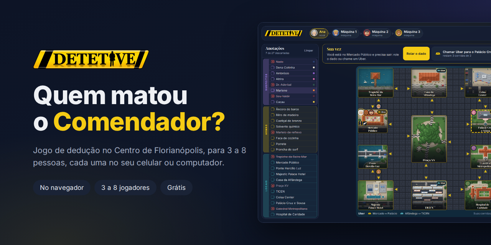
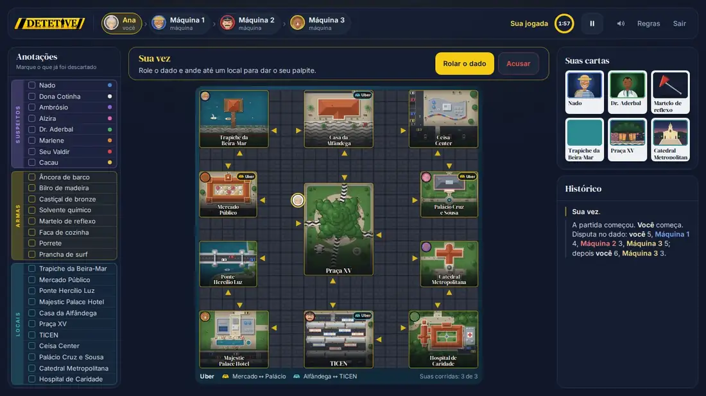
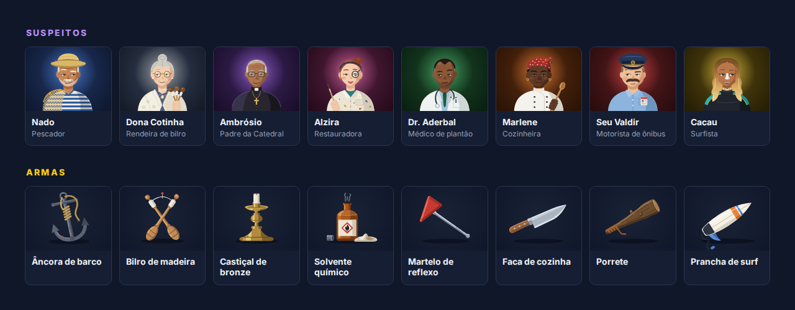
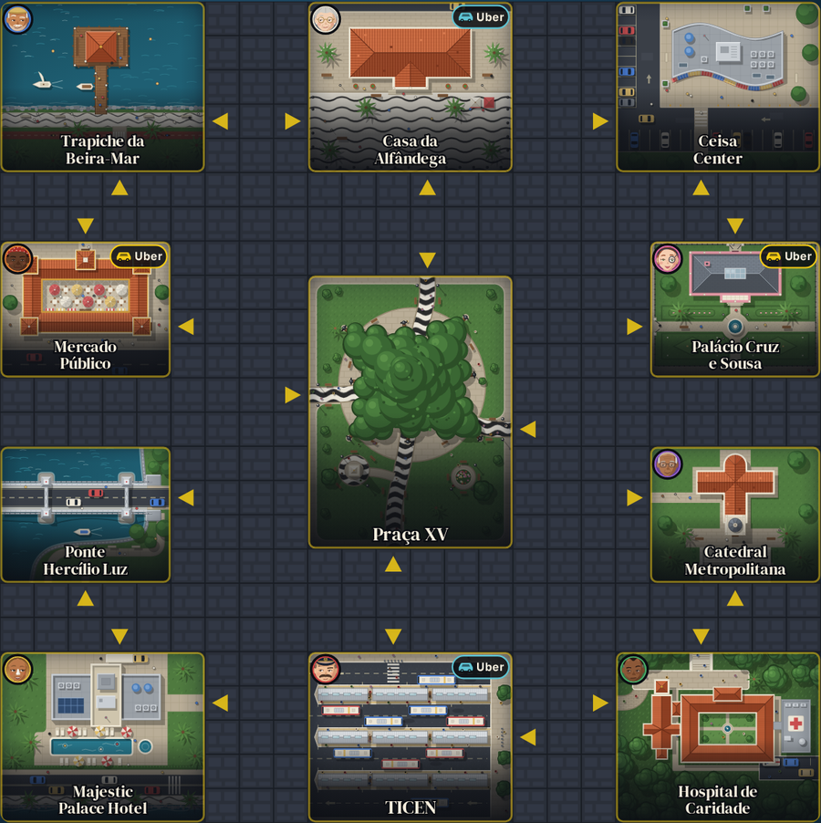
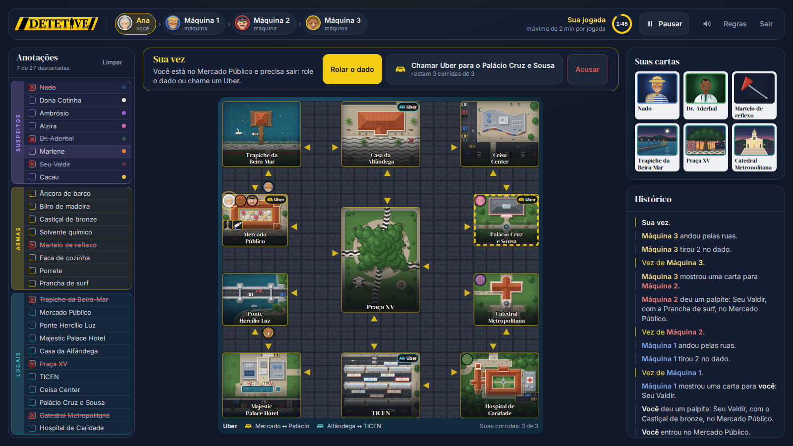
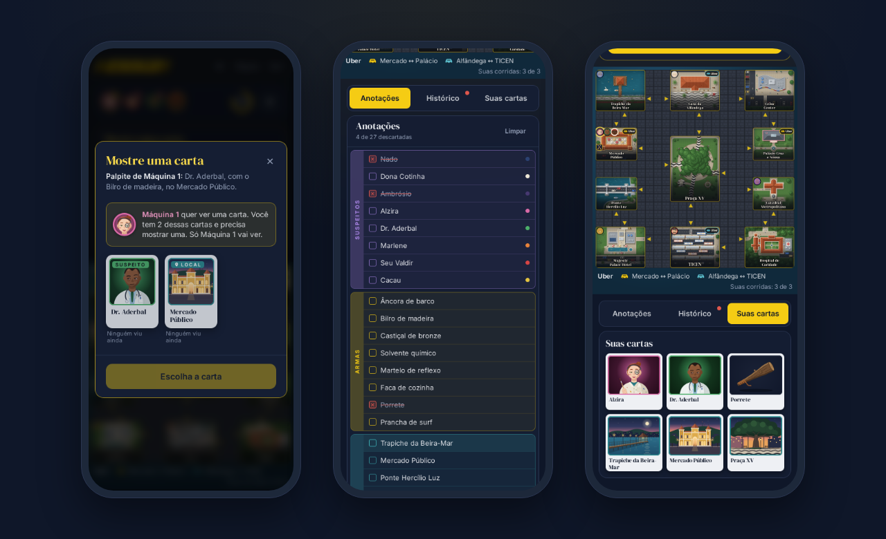
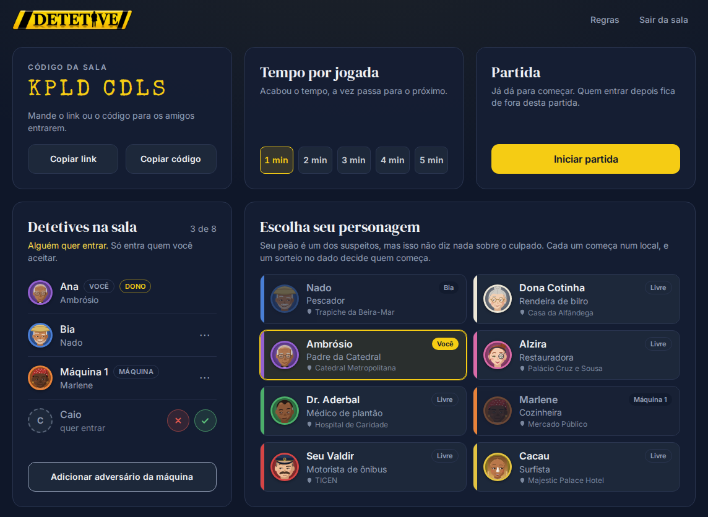

  

  <a href="https://detetive.spaceplay.fun"><b>Jogar agora</b></a>
  &nbsp;·&nbsp; no navegador do celular ou do computador &nbsp;·&nbsp; grátis e sem cadastro

Detetive: Crime na Ilha é um jogo de dedução para jogar com os amigos pela internet. O Comendador
Hilário Bittencourt, o empresário mais rico da Ilha, foi encontrado morto no Centro de Florianópolis.
Cada jogador, no seu celular ou computador, anda pelo tabuleiro, dá palpites e cruza as pistas para
descobrir quem foi, com que arma e em que lugar antes dos outros detetives.

  

## O caso

  

São 8 suspeitos, 8 armas e 11 locais do Centro, todos com ilustração própria. No começo, uma carta
de cada tipo vai para o envelope sem ninguém ver: é a solução do crime. As outras são repartidas
entre os jogadores.

## O tabuleiro

  

O Centro de Florianópolis visto de cima, com a Praça XV no meio e cartões-postais como o Mercado
Público, a Ponte Hercílio Luz e a Catedral em volta. Na sua vez, você rola o dado e anda pelas ruas
até um local. Os pontos de Uber levam direto para o outro lado do tabuleiro, sem dado, três vezes por
partida.

## A partida

  

Ao entrar num local, você dá um palpite: um suspeito e uma arma, naquele lugar. Quem tiver uma dessas
cartas mostra uma, só para você. As anotações ficam ao lado do tabuleiro, separadas por cor, e o
histórico conta tudo o que aconteceu na mesa. Quando tiver certeza, faça a acusação: acertou, ganhou;
errou, está fora. Cada jogada tem tempo, de 1 a 5 minutos, então ninguém fica esperando.

## Cada um no seu aparelho

  

No celular, o tabuleiro fica em cima e as anotações, o histórico e as cartas ficam em abas logo
abaixo. Suas cartas e o que mostraram para você só aparecem na sua tela.

## Monte a sala

  

Quem cria a sala recebe um código de 8 letras e um link para mandar para a turma, aceita quem pede para
entrar e pode completar a mesa com adversários da máquina. Para aprender sozinho, tem o treino contra a
máquina, que segue as mesmas regras e só sabe o que um jogador saberia.

## Por dentro

O jogo roda no navegador e foi feito em TypeScript com React, montado com Vite e Tailwind CSS. O
servidor é PHP puro: cada sala fica guardada num arquivo, e o navegador pergunta a cada segundo o que
mudou. Assim o jogo roda numa hospedagem compartilhada comum, sem banco de dados.

É o servidor que confere cada jogada contra as regras e a vez de cada um. Cada jogador só recebe as
próprias cartas, e o envelope não sai de lá antes do fim. As ilustrações são desenhos próprios em SVG,
e os sons são gerados pelo navegador, sem arquivos de áudio. As regras têm testes automáticos.

React · TypeScript · Vite · Tailwind CSS · PHP 8 · PHPUnit · Vitest

O código fica num repositório privado. Este repositório é a vitrine do jogo.

---

Feito por [Rodrigo Dias](https://github.com/rmgladius). Detetive é um jogo da [Spaceplay](https://spaceplay.fun).
